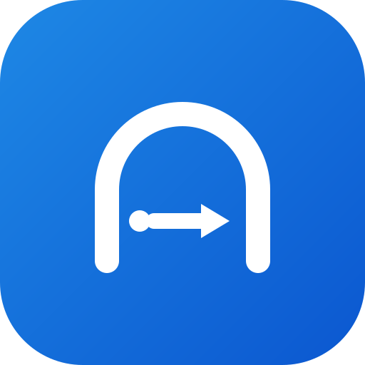
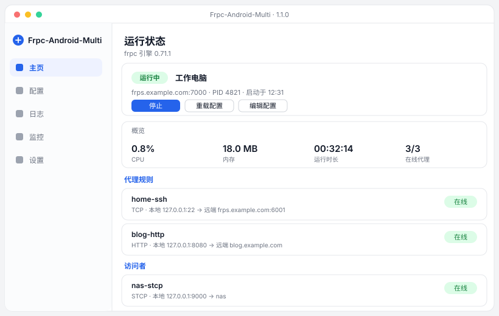
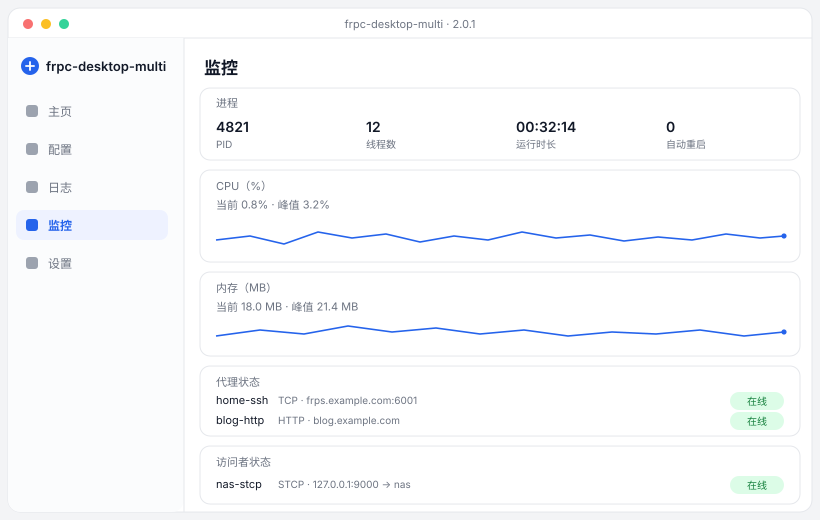
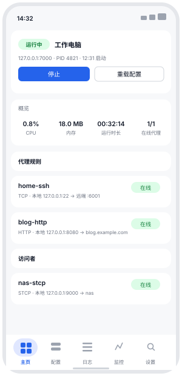
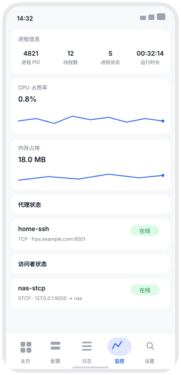

<div align="center">
  
  <h1>frpc-desktop-multi</h1>
  <p><b>A GUI client for frp (fast reverse proxy)</b> · Windows / Linux / macOS / Android<br>Configure, run and monitor frpc tunnels — all in one window</p>

  <p>
    
    
    
    
    
  </p>

  <p>
    <a href="https://github.com/fdmdf/frpc-desktop-multi/releases/latest"></a>
    <a href="https://github.com/fdmdf/frpc-desktop-multi/actions/workflows/tauri.yml"></a>
  </p>

  <p>
    <a href="README.md">简体中文</a> · <b>English</b>
  </p>
</div>

---

A cross-platform desktop and Android GUI for [frp](https://github.com/fatedier/frp). It wraps the `frpc` client in a proper interface: build tunnels from forms instead of editing TOML by hand, start and stop them in one click, and watch live status, logs and resource usage. The frpc engine is bundled and compiled natively per platform, so there is nothing to install first — no Go toolchain, no Java, no manual binary download.

## Features

- **Visual config editor** — 8 proxy types and 3 visitors, each with a type-specific form. Validation before saving: required fields, port conflicts, duplicate names, fields the type does not support.
- **Start / stop / hot reload** — one click to run or stop; automatic restart with exponential backoff if the process exits unexpectedly.
- **Live tunnel status** — reads frpc's admin API first (including the real remote port assigned by the server), falls back to log inference when the API is off. Visitor status is visible too.
- **Metrics and logs** — CPU, memory, thread count and uptime sampled in real time; logs with level filtering, search and export.
- **Self-contained** — the frpc engine ships inside the app, natively built for each platform.
- **Launch at login** — writes the per-user Run key on Windows, a LaunchAgent on macOS and an XDG autostart entry on Linux; no admin rights needed, toggleable any time, and re-pointed automatically if the executable moves after an upgrade ([platform notes](docs/autostart.md)).
- **Bilingual UI** — Simplified Chinese and English, switchable in-app or following the system locale.
- **One core, two frontends** — a Rust core layer (`frpc-core`) plus a Vue 3 interface, shared by the desktop app and the Android app.

## Screenshots

<table>
  <tr>
    <td><br><sub>Desktop · Home: run state, overview, proxy rules and visitors</sub></td>
  </tr>
  <tr>
    <td><br><sub>Desktop · Monitor: process, CPU / memory curves, proxy and visitor status</sub></td>
  </tr>
  <tr>
    <td align="center">
      
      
      <br><sub>Android · Home / Monitor</sub>
    </td>
  </tr>
</table>

> These are layout-accurate mockups drawn with the app's real palette and information hierarchy, not captures.

## Download

| Platform | File | Size |
|---|---|---|
| Windows x64 | `frpc-desktop-multi_<ver>_x64-setup.exe` | 7.1 MB |
| Windows x64 | `frpc-desktop-multi_<ver>_x64_en-US.msi` | 9.5 MB |
| Linux x64 | `frpc-desktop-multi_<ver>_amd64.deb` / `.AppImage` | 10 MB / 84 MB |
| macOS arm64 | `frpc-desktop-multi_<ver>_aarch64.dmg` | 8.7 MB |
| Android arm64 | `frpc-desktop-multi-<ver>-arm64.apk` | 10.5 MB |

The macOS build is unsigned — allow it under System Settings → Privacy & Security on first launch. The Android APK is signed with the fixed key committed in `tauri/android-signing/`; CI verifies the certificate fingerprint and aborts the release on mismatch.

## Quick start

1. Go to **Config → New**: enter the frps address, port and token, and keep the admin API (webServer) enabled.
2. Add a proxy rule, for example TCP: local `22` → remote `6001` (leave the remote port empty to let frps assign one).
3. Return to **Home** and hit **Start**. Once the log shows `login to server success`, the tunnel is up.

Data directory: `~/.frpcdash/` on desktop (config, engine, the running TOML); the app-private directory on Android.

## Supported protocols

| Proxy type | Server requirement | Notes |
|---|---|---|
| tcp / udp | `allowPorts` must permit the remote port | Fixed port forwarding |
| http / https | `vhostHTTPPort` / `vhostHTTPSPort` | Routed by domain; https is TLS passthrough, so the local service must speak HTTPS itself |
| tcpmux | `tcpmuxHTTPConnectPort` | `multiplexer = httpconnect`, uses HTTP CONNECT |
| stcp / sudp / xtcp | none | Secret proxy plus a visitor; xtcp needs STUN reachability (self-host one and set `natHoleStunServer`) |

Transport layer supports `tcp` / `kcp` / `quic` / `websocket` / `wss`, with a TLS toggle.

## Build from source

Requires **Rust 1.85+**, **Node 20+** and **Go 1.21+** (to compile the frpc engine). Building the APK additionally needs the Android SDK and NDK 27.2.

```bash
bash scripts/build-frpc.sh desktop        # build engine -> tauri/app/src-tauri/resources/engine
cargo test --manifest-path tauri/Cargo.toml -p frpc-core    # core layer unit tests (89)
cd tauri/app/ui && npm ci && npm run build                  # frontend bundle
cd tauri/app && ui/node_modules/.bin/tauri build            # desktop installers
bash scripts/tauri-e2e.sh                 # 8-protocol end-to-end (real frps + frpc)
```

Android:

```bash
bash scripts/build-frpc.sh android                    # -> tauri/engines/android/jniLibs
export ANDROID_HOME=... NDK_HOME=...
bash scripts/tauri-android-setup.sh                   # generate gen/android and patch gradle
cd tauri/app && ui/node_modules/.bin/tauri android build --apk --target aarch64
```

The end-to-end suite encodes a profile into `frpc.toml` with the app's own encoder, verifies it through `frpc verify`, then builds real tunnels and checks connectivity for tcp / udp / http / https / stcp / xtcp / tcpmux / sudp one protocol at a time.

## Project layout

```
tauri/
  crates/frpc-core/   Rust core: models / TOML / validation / admin API / logging / metrics / ports / storage / supervision
  app/src-tauri/      Tauri desktop shell and command bridge
  app/ui/             Vue 3 interface (shared by desktop and Android)
  engines/android/    Android engine artifacts (jniLibs, generated by build-frpc.sh, not tracked)
scripts/              Engine build, Android project setup, end-to-end tests
docs/wiki/            User documentation
.github/workflows/tauri.yml   CI: core tests + desktop bundles for three platforms + Android APK
```

## Known limitations

- Advanced fields such as `healthCheck`, `loadBalancer`, `includes` and proxy annotations are not modelled and are dropped on TOML import. `plugin` supports `https2http` / `tls2raw` for HTTPS; other plugin types are preserved verbatim on import but cannot be edited.
- Android ships `arm64-v8a` only.
- macOS builds are unsigned and not notarized.
- Configuration cannot be edited while the service is running — stop it first, to avoid the "I changed it but nothing happened" trap.
- xtcp relies on UDP hole punching: a system proxy or virtual adapter (TUN), symmetric NAT or an emulator network can all prevent the tunnel from coming up. If the log says `establishing nat hole connection successful` but traffic still fails, disable the system proxy or switch networks and retry.

## Related projects

| Project | Relationship |
|---|---|
| [fatedier/frp](https://github.com/fatedier/frp) | The engine bundled here — the official frpc / frps implementation (Apache-2.0) |
| [frp docs](https://gofrp.org/) | Authoritative reference for options, protocols and frps server deployment |
| [Tauri](https://github.com/tauri-apps/tauri) | Desktop shell and packaging, cross-platform windows and OS integration |
| [Vue 3](https://github.com/vuejs/core) | UI framework, shared across desktop and Android |
| [ngrok](https://ngrok.com/) · [Cloudflare Tunnel](https://developers.cloudflare.com/cloudflare-one/connections/connect-networks/) | Hosted alternatives that need no public server of your own; this project targets self-hosted frps |

## License

MIT. The bundled engine comes from [fatedier/frp](https://github.com/fatedier/frp) (Apache-2.0).
