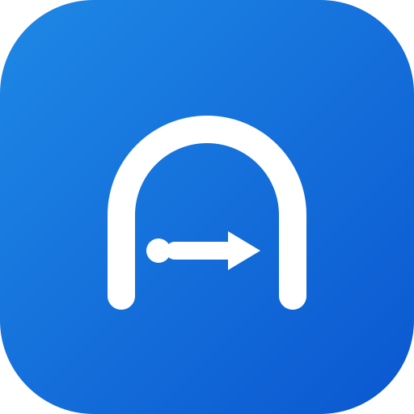
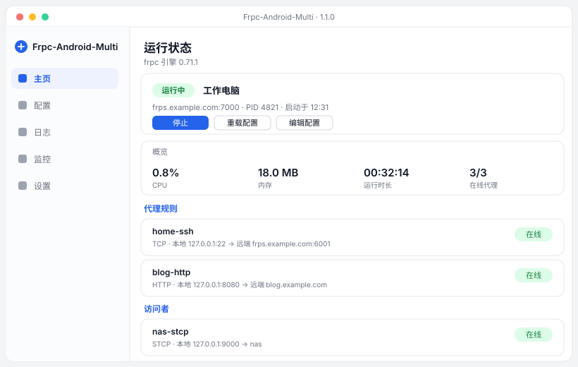
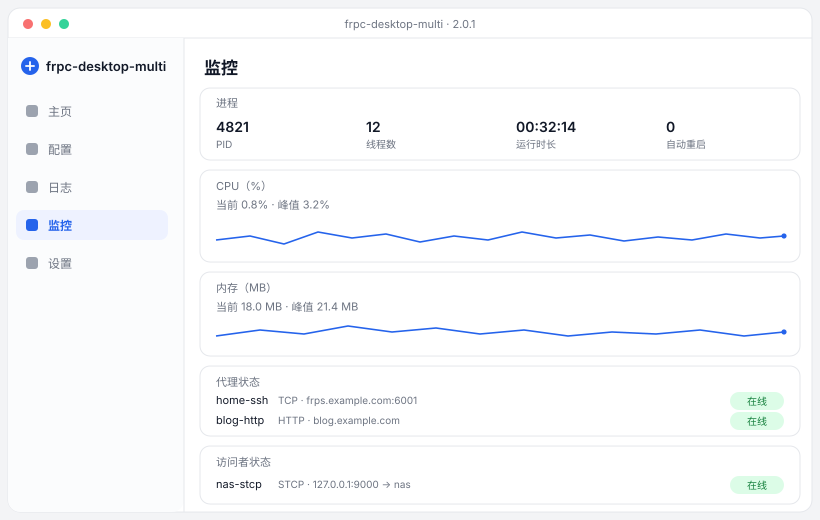
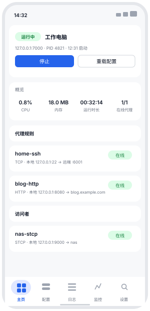
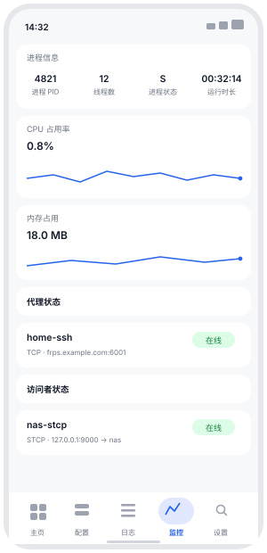

<div align="center">
  
  <h1>frpc-desktop-multi</h1>
  <p><b>frp 内网穿透的可视化客户端</b> · Windows / Linux / macOS / Android<br>配置、启停、日志、监控，全在一个界面里</p>

  <p>
    
    
    
    
    
  </p>

  <p>
    <a href="https://github.com/fdmdf/frpc-desktop-multi/releases/latest"></a>
    <a href="https://github.com/fdmdf/frpc-desktop-multi/actions/workflows/tauri.yml"></a>
  </p>
</div>

---

## 特性

- **可视化配置**：8 种代理类型 + 3 种访问者，按类型生成表单，保存前自动校验（必填、端口占用、重名、类型不支持的字段）
- **一键启停**：启动 / 停止 / 热重载；进程异常退出按指数退避自动重启
- **真实状态**：优先读 frpc 的 admin API（含真实远程端口），接口关闭时用日志推断；访问者状态同样可见
- **资源与日志**：CPU / 内存 / 线程 / 运行时长实时采样；日志分级过滤、搜索、导出
- **开箱即用**：内置 frpc 引擎，各平台原生编译，用户不需要装 Java、Go 或手动下载二进制
- **双语界面**：简体中文 / English，应用内切换，也可跟随系统
- **一份代码两端跑**：Rust 核心层（`frpc-core`）+ Vue 3 界面，桌面与 Android 共用同一份实现；安装包只有旧版的 1/10

> v1.4.0 起由 Tauri 2 + Rust 重写，替代原先的 Kotlin Multiplatform / Compose 实现。
> 旧实现已归档在 `archive/kotlin-legacy` 分支，不再随新版本发布。

## 界面

<table>
  <tr>
    <td><br><sub>桌面端 · 主页：运行状态、概览、代理规则与访问者</sub></td>
  </tr>
  <tr>
    <td><br><sub>桌面端 · 监控：进程、CPU / 内存曲线、代理与访问者状态</sub></td>
  </tr>
  <tr>
    <td align="center">
      
      
      <br><sub>Android · 主页 / 监控</sub>
    </td>
  </tr>
</table>

> 图为按实际界面布局绘制的示意图（同一套配色与信息层级），非截图。

## 下载

| 平台 | 文件 | 大小 |
|---|---|---|
| Windows x64 | `frpc-desktop-multi_<ver>_x64-setup.exe` | 7.1 MB |
| Windows x64 | `frpc-desktop-multi_<ver>_x64_en-US.msi` | 9.5 MB |
| Linux x64 | `frpc-desktop-multi_<ver>_amd64.deb` / `.AppImage` | 10 MB / 84 MB |
| macOS arm64 | `frpc-desktop-multi_<ver>_aarch64.dmg` | 8.7 MB |
| Android arm64 | `frpc-desktop-multi-<ver>-arm64.apk` | 10.5 MB |

macOS 产物未签名，首次启动需在「系统设置 → 隐私与安全性」允许。Android APK 由 CI 用临时密钥签名，签名失败时工作流会直接终止，不会发出装不上的产物。

## 快速开始

1. 「配置」→ 新建：填 frps 地址、端口、Token，保持「状态接口（webServer）」开启
2. 添加代理规则，例如 TCP：本地 `22` → 远程 `6001`（留空则由 frps 随机分配）
3. 回「主页」点「启动」，日志出现 `login to server success` 即成功

数据目录：桌面端 `~/.frpcdash/`（配置、引擎、运行中的 toml）；Android 为应用私有目录。

## 协议支持

| 代理类型 | 服务端要求 | 说明 |
|---|---|---|
| tcp / udp | `allowPorts` 放行 remotePort | 固定端口转发 |
| http / https | `vhostHTTPPort` / `vhostHTTPSPort` | 按域名路由；https 为 TLS 透传，本地服务需自己说 HTTPS |
| tcpmux | `tcpmuxHTTPConnectPort` | `multiplexer = httpconnect`，走 HTTP CONNECT |
| stcp / sudp / xtcp | 无 | 私密代理 + 访问者；xtcp 需要能连上 STUN（可自建并填 `natHoleStunServer`） |

传输层支持 `tcp` / `kcp` / `quic` / `websocket` / `wss` 与 TLS 开关。

## 从源码构建

需要 **Rust 1.85+**、**Node 20+**、**Go 1.21+**（编译 frpc 引擎）；打 APK 另需 Android SDK + NDK 27.2。

```bash
bash scripts/build-frpc.sh desktop        # 编译引擎 -> tauri/app/src-tauri/resources/engine
cargo test --manifest-path tauri/Cargo.toml -p frpc-core    # 核心层单测（88 项）
cd tauri/app/ui && npm ci && npm run build                  # 前端产物
cd tauri/app && ui/node_modules/.bin/tauri build            # 桌面安装包
bash scripts/tauri-e2e.sh                 # 八协议端到端（真跑 frps + frpc）
```

Android：

```bash
bash scripts/build-frpc.sh android                    # -> tauri/engines/android/jniLibs
export ANDROID_HOME=... NDK_HOME=...
bash scripts/tauri-android-setup.sh                   # 生成 gen/android 并打 gradle 补丁
cd tauri/app && ui/node_modules/.bin/tauri android build --apk --target aarch64
```

端到端测试会用应用自己的编码器把档案导出成 `frpc.toml`，经 `frpc verify` 校验后真实建隧道，逐个协议验证 tcp / udp / http / https / stcp / xtcp / tcpmux / sudp 的连通性。

## 项目结构

```
tauri/
  crates/frpc-core/   Rust 核心层：模型 / TOML / 校验 / admin API / 日志 / 指标 / 端口 / 存储 / 监管
  app/src-tauri/      Tauri 桌面端外壳与命令桥
  app/ui/             Vue 3 界面（桌面与 Android 共用）
  engines/android/    Android 引擎产物（jniLibs，由 build-frpc.sh 生成，不入库）
scripts/              引擎编译、Android 工程初始化、端到端测试
docs/wiki/            使用文档
.github/workflows/tauri.yml   CI：核心层测试 + 三平台桌面包 + Android APK
```

## 已知限制

- 健康检查（`healthCheck`）、`loadBalancer`、`includes`、代理注解等高级字段未建模，导入 TOML 时会被忽略；`plugin` 已支持 https 的 `https2http` / `tls2raw`，其它插件类型导入后原样保留但不可编辑
- Android 目前只打 `arm64-v8a`
- macOS 产物未签名 / 未公证
- Android 端前台服务保活（后台持续运行）尚未实现
- 运行中的配置不可编辑，需先停止服务（避免"改了没生效"的误解）
- xtcp 依赖 UDP 打洞：系统代理 / 虚拟网卡（TUN）、对称型 NAT、模拟器网络都可能让它建不上隧道。日志出现 `establishing nat hole connection successful` 仍不通时，先关掉系统代理或换网络再试

## 许可

MIT。内置引擎来自 [fatedier/frp](https://github.com/fatedier/frp)（Apache-2.0）。
