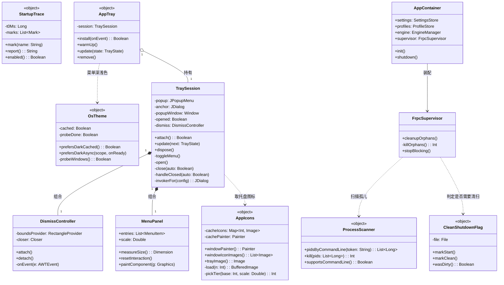
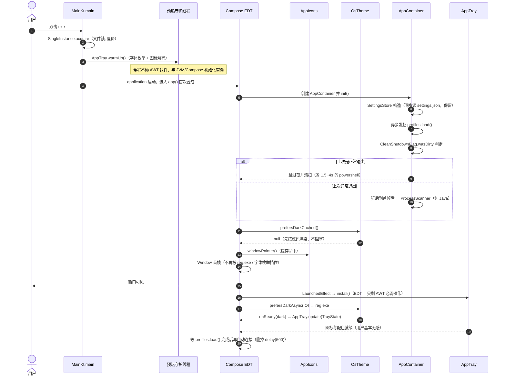
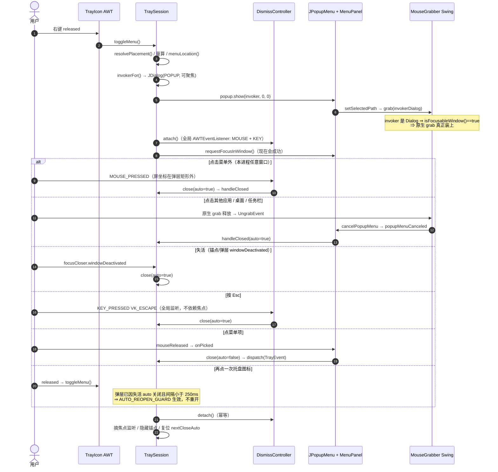
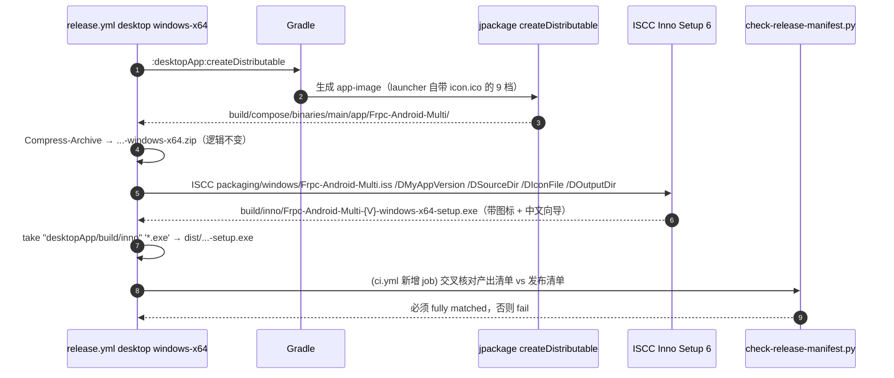

# Windows 桌面端四项缺陷：根因分析、方案设计与任务分解

- 仓库：`frpc-desktop-multi`（产品名 `Frpc-Android-Multi`），分支 `dev`
- 作者：架构师
- 范围：冷启动缓慢 / 托盘菜单点击外部不关闭 / 托盘图标与主程序图标不一致 / 安装包无图标且向导非中文
- 本文只做设计，不改代码。所有结论都标了证据来源（文件:行号、JDK 源码、本地已构建产物实测）

---

## 0. 现状速览与全局约束

| 项 | 值 |
|---|---|
| Compose Multiplatform | `1.12.2`（`gradle/libs.versions.toml`） |
| JDK 工具链 | 17（两端一致） |
| 桌面端入口 | `desktopApp/src/main/kotlin/com/frpc/desktop/Main.kt` |
| 托盘 | `ui/AppTray.kt`（自绘菜单 + `JPopupMenu` 外壳） |
| 打包 | jpackage（CMP `nativeDistributions`），GitHub Actions `windows-latest` |
| 当前版本 | `1.3.1`（`desktopApp/build.gradle.kts:27` 兜底值、`androidApp/build.gradle.kts:17` `versionName` 一致） |

**本轮必须遵守的约束（写进每条任务的验收标准）**

1. 只改本地文件：不 commit / 不 push / 不打 tag / 不触发 Release。
2. 不产出任何分发产物：只允许 `compileKotlin` / `compileJava` 与单元测试；图标生成脚本（`java scripts/gen-tray-icons/GenTrayIcons.java`）可以跑——它只写资源文件。
3. jpackage 元信息（`description` / `copyright` / `vendor`）继续纯 ASCII（GBK 下中文会 `Input length = 1`）。Inno Setup 的 `VersionInfo*` 同理保持 ASCII。
4. workflow 的 `name:` 字段值里不能出现 `": "`。
5. CI 里 `| tee` 必须配 `set -euo pipefail`。
6. 新增脚本保持 `100755`；新增依赖必须走 `gradle/libs.versions.toml`。
7. 两端一视同仁：本次 4 项均为 Windows 桌面端特有；若触及 `:shared`，需同步评估 Android 影响并在注释里写明。

---

## 1. 问题一：冷启动缓慢

### 1.1 启动路径全景（按时间顺序）

```
main(args)  Main.kt:98
 ├─ SingleInstance.acquire(File(AppPaths.home,"app.lock"))  Main.kt:116
 │    └─ AppPaths object init → resolveHome()（mkdirs + 旧目录迁移） AppPaths.kt:32
 │    └─ 文件锁 + ServerSocket(47654)  SingleInstance.kt:30
 └─ app() = application { ... }  Main.kt:130
      ├─ 第一次 composition（EDT 上执行）
      │    ├─ remember { AppContainer().also { it.init() } }      Main.kt:131
      │    │     ├─ SettingsStore(settingsFile) 构造期同步读文件 + 建 Json 实例   SettingsStore.kt:27-33
      │    │     ├─ ProfileStore / EngineManager / FrpcSupervisor 构造（轻量）
      │    │     └─ init()
      │    │          ├─ scope.launch { profiles.load() }         AppContainer.kt:22（异步）
      │    │          ├─ supervisor.cleanupOrphans()              AppContainer.kt:24（异步，但 fork powershell）
      │    │          └─ Runtime.addShutdownHook(...)             AppContainer.kt:26（廉价）
      │    ├─ val darkMenu = remember { ... OsTheme.prefersDark() }  Main.kt:197-203  ★同步 fork reg.exe
      │    └─ if (windowVisible) Window(icon = appIconPainter(), ...) Main.kt:284-286  ★每次重组解码 512 PNG
      │           └─ Sidebar(version = container.engine.bundledVersion())  Main.kt:330  ★每次重组读 /engine/VERSION
      └─ 首帧渲染（EDT）
      └─ LaunchedEffect 依次启动（仍在 EDT 上排队）
           ├─ LaunchedEffect(Unit) { AppTray.install(...) }        Main.kt:277  ★字体枚举 + ImageIO + SystemTray
           ├─ LaunchedEffect(Unit) { delay(500); 自动连接 }         Main.kt:206-221 ★固定 500ms + 与 load 竞态
           └─ LaunchedEffect(darkMenu, trayTooltip) { AppTray.update(...) }  Main.kt:279
```

### 1.2 根因逐条（含证据）

**① `OsTheme.prefersDark()` 在 Compose 主线程同步 fork `reg.exe`（最大嫌疑）**

- `Main.kt:197-203`：`val darkMenu = remember(settings.theme) { when (settings.theme) { "dark" -> true; "light" -> false; else -> OsTheme.prefersDark() } }`
- `SettingsData.theme` 默认 `"system"`（`SettingsStore.kt:13`），所以**首次启动必然走到 `prefersDark()`**。
- `OsTheme.kt:32-40` → `exec("reg", "query", ...)` → `ProcessBuilder.start()` + `waitFor(3s)`，全部在调用线程上。
- 调用线程 = `remember {}` 的求值线程 = **EDT**（Compose Desktop 的 composition 跑在 AWT EDT 上）。
- 代价：创建进程 + `reg.exe` 冷启动，Windows 上通常 **150~600ms**；若杀软介入扫描新进程，可能到 1s。
- 它卡在 `Window(...)` 之前（第 197 行 vs 第 284 行），**直接推迟窗口创建**。

**② `AppTray.install()` 全同步跑在 EDT，内含系统字体枚举**

- `Main.kt:277`：`LaunchedEffect(Unit) { AppTray.install(::handleTrayEvent) }`。`rememberCoroutineScope()` 用的是 `kotlinx-coroutines-swing` 的 Main dispatcher = **EDT**。
- `AppTray.kt:104-124` `install()` → `onEdt { ... }`；`onEdt` 在已处于 EDT 时**直接内联执行**（`AppTray.kt:707-713`）。
- 于是下面三件重活全部落在 EDT：
  1. `TraySession` 构造 → `MenuPanel(...)` → `MENU_FONT` lazy（`AppTray.kt:474-484`）→ **`GraphicsEnvironment.getLocalGraphicsEnvironment().availableFontFamilyNames`**，即全量枚举系统字体。Windows 上这是出了名的慢（**300ms~1.5s**，字体多/网络字体时更久）。
  2. `loadTrayImage()`（`AppTray.kt:686-690`）→ `ImageIO.read` **首次调用会做 ImageIO SPI 扫描**（ServiceLoader 遍历所有 `javax.imageio.spi.*`），约 50~150ms。
  3. `attach()` → `SystemTray.getSystemTray().add(...)`（`AppTray.kt:265-274`）→ AWT 原生托盘初始化，50~200ms。
- 另外 `MenuPanel` 构造还调 `screenScale(null)`（`AppTray.kt:701-703`），强制触发 `GraphicsEnvironment` 初始化。
- 这些与首帧渲染在同一条 EDT 消息队列上争抢：无论排在首帧前还是后，用户感知都是"双击后卡一下才出窗口 / 出了窗口还卡一下"。

**③ `appIconPainter()` 每次重组都重新解码 512×512 PNG**

- `Main.kt:92-96`：`getResourceAsStream("/icon.png")?.readBytes()` → `Image.makeFromEncoded(...).toComposeImageBitmap()`。
- 它在 `Window(icon = appIconPainter(), ...)`（`Main.kt:286`）里作为实参表达式，**每次 `app()` 重组都执行一次**。
- `app()` 订阅了 `settings.state / supervisor.state / status / visitors / activeCounts / profiles.profiles` 六个 Flow（`Main.kt:133, 224-228`），其中 `status` 每 4s、`metrics` 每 2s 更新 → 稳态下也在不停解码 41KB PNG 并创建新 `ImageBitmap`，是持续的 GC 压力源。
- 首帧代价 10~40ms；长期影响更大。

**④ `container.engine.bundledVersion()` 每次重组读一次 `/engine/VERSION`**

- `Main.kt:330`：`Sidebar(version = container.engine.bundledVersion())`。
- `EngineManager.kt:14-18`：每次 `getResourceAsStream("/engine/VERSION")?.bufferedReader()?.use { readText() }`，没有任何缓存。
- 单次很便宜（jar 内小文件），但同样随重组反复触发，且首帧必付。

**⑤ `cleanupOrphans()` 每次启动都 fork `powershell` 做 CIM 查询**

- `AppContainer.kt:24` → `FrpcSupervisor.kt:195-232`。**注意：它已经跑在 `Dispatchers.IO`，不阻塞 EDT**，所以不是"主线程阻塞"型瓶颈。
- 但 `killOrphans()` 在 Windows 上无条件 `ProcessBuilder("powershell","-NoProfile","-NonInteractive","-Command", "Get-CimInstance Win32_Process ...")`（`FrpcSupervisor.kt:211`）。PowerShell 冷启动 + CIM 查询通常 **1.5~4s**，且与首屏争抢 CPU、磁盘和杀软扫描。
- 更糟的是：**无论上次是否正常退出都扫**。绝大多数启动都是白扫一次。
- 结论：这是"间接拖慢首屏"的第二梯队因素（0.2~1s），并且是每次启动的固定成本。

**⑥ 自动连接的固定 `delay(500)` 与 `profiles.load()` 竞态**

- `Main.kt:206-221`：`LaunchedEffect(Unit) { delay(500); ... container.profiles.find(s.defaultProfileId) ?: container.profiles.profiles.value.firstOrNull() ... }`。
- `profiles.load()` 是 `AppContainer.kt:22` 里**异步**发起的。500ms 是拍脑袋的固定值：配置多/磁盘慢时 `profiles.value` 还是空，于是 `profile` 为 `null`，**自动连接静默失败**（既不启动也不报错）。
- 这是"功能延迟 + 潜在 bug"，不是首屏延迟，但用户感知就是"开机自启后半天没连上"。

**⑦ `SettingsStore` 构造期同步 IO / jpackage JVM 参数**

- `SettingsStore.kt:27-29`：`private val _state = MutableStateFlow(read())`，构造即同步读 `settings.json` + 建 `Json { prettyPrint = true }` 实例。文件通常 <1KB，实测 5~30ms，属可接受范围，**不建议动**（改成惰性的收益/风险比不划算）。
- `ProfileStore` 构造期不读盘（`load()` 是 suspend）✅。
- `build.gradle.kts:72`：jpackage 只加了 `-Dfile.encoding=UTF-8`，没有任何启动加速器（无 AppCDS、无 GC 选择、无 TieredStopAtLevel）。
- `UpdateChecker` **不在启动路径上**：只在用户点"检查更新"时 `Main.kt:187` 调用，且已在 `Dispatchers.IO`。✅ 排除。
- 启动路径上**没有端口扫描**：`PortCheck` 只在 `checkBeforeStart` / `stopInternal` 里用。✅ 排除。

### 1.3 瓶颈排序与预期收益

> 下表耗时为**经验估值**，必须在 T02 埋点后用真机日志校准（见 §1.4 的 `StartupTrace`）。

| 序 | 瓶颈 | 类型 | 预估耗时 | 优化后 | 优先级 |
|---|---|---|---|---|---|
| ① | `OsTheme.prefersDark()` fork `reg.exe` | **EDT 同步阻塞** | 150~600ms | ≈0（后台算 + 先用默认值） | P0 |
| ② | `AppTray.install()` 字体枚举 + ImageIO + 托盘初始化 | **EDT 同步阻塞** | 300~1500ms | ≈0~50ms（后台预热 + 只把必须碰 AWT 的部分留在 EDT） | P0 |
| ⑤ | `cleanupOrphans()` fork powershell | 后台抢 CPU/IO | 间接 200~1000ms | ≈0（正常退出时完全跳过；必要时用纯 Java 扫） | P0 |
| ③ | `appIconPainter()` 每次解码 512 PNG | EDT 重组期 | 首帧 10~40ms + 稳态持续 | 一次性缓存 + 按档位取图 | P0 |
| ④ | `bundledVersion()` 每次读资源 | EDT 重组期 | 1~10ms/次 | 缓存 | P1 |
| ⑥ | `delay(500)` + 与 `load()` 竞态 | 功能延迟/正确性 | 500ms + 可能静默失败 | 等 `load()` 完成再连 | P0 |
| ⑦ | JVM / Compose / Skia 基线 | 固有 | 1.5~3s | 小幅（见下） | P2 |

**优化后预期**：EDT 上的同步阻塞（①+②）合计可减少 **0.45~2.1s**；后台争抢（⑤）再省 **0.2~1s**；自动连接（⑥）提前并消除竞态。典型机器上"双击 → 窗口可见"应能压到 **1.5s 以内**（基线 1.5~3s 中能动的都动了，剩下的主要是 JVM/Skia 固有成本）。

⑦的可选手段（**P2，需实测，默认不做**）：
- `jvmArgs += "-XX:+UseSerialGC"`（小堆桌面程序冷启动更快；Compose 的像素内存主要在 native）
- `jvmArgs += "-XX:CICompilerCount=2"`（减少 JIT 线程抢 CPU）
- `nativeDistributions { modules = listOf(...) }` 显式精简 jlink 运行时模块
- **不要**用 `-XX:TieredStopAtLevel=1`：本应用是长时间驻留型，C2 缺席会影响稳态。

### 1.4 优化方案

| 编号 | 改动 | 位置 |
|---|---|---|
| A1 | 新增 `core/StartupTrace.kt`：以 `ManagementFactory.getRuntimeMXBean().startTime()` 为 `t0`，埋 12~20 个里程碑；`-Dfrpc.startupTrace=true` 时打到 stdout，其余时候只在内存留档供日志页查看 | 新增 |
| A2 | `OsTheme` 改为**异步 + 缓存**：`prefersDarkCached()` 立即返回上次/默认（浅色），`prefersDarkAsync(scope) { ... }` 在 `Dispatchers.IO` 上 fork `reg.exe` 并回写缓存；`Main.kt` 里 `darkMenu` 先取缓存值，异步结果回来后通过已有的 `AppTray.update()` 通道刷新（`Main.kt:279` 的 `LaunchedEffect(darkMenu, trayTooltip)` 天然支持） | `core/OsTheme.kt`, `Main.kt` |
| A3 | `AppTray` 预热拆分：新增 `AppTray.warmUp()`（**不碰 AWT 组件**，只做 `availableFontFamilyNames` 枚举 + 图标解码 + `MENU_FONT` 解析），在 `main()` 里起一个守护线程调用；`install()` 只保留必须走 EDT 的部分。`MENU_FONT` 的字体名集合缓存到 `@Volatile` 字段 | `ui/AppTray.kt`, `Main.kt` |
| A4 | 图标解码缓存 + 多档位：见 §3（`ui/AppIcons.kt`），`appIconPainter()` 替换为 `remember { AppIcons.windowPainter() }` | `Main.kt`, `ui/AppIcons.kt` |
| A5 | `EngineManager.bundledVersion()` 用 `@Volatile` 字段缓存；`Main.kt` 里再套一层 `remember` | `engine/EngineManager.kt`, `Main.kt` |
| A6 | 孤儿进程清扫改为**有条件 + 纯 Java**：新增 `runtime/ProcessScanner.kt`，优先用 `ProcessHandle.allProcesses()` + `info().commandLine()` 过滤（JDK 9+，Windows 可用，零 fork）；失败才回退 powershell。新增 `core/CleanShutdownFlag.kt`：启动时写 `~/.frpcdash/.running`，正常 `shutdown()` 时删除；下次启动若文件不存在则**完全跳过清扫**。即使要扫，也延后到首帧之后（在 `Main.kt` 的窗口 `LaunchedEffect` 里发起，而不是 `AppContainer.init()`） | 新增 ×2, `AppContainer.kt`, `engine/FrpcSupervisor.kt` |
| A7 | 自动连接改为等待配置加载：`ProfileStore` 暴露 `load()` 返回的 `Job`（或一个 `loaded: StateFlow<Boolean>`），`Main.kt` 里 `profiles.awaitLoaded(); delay(0)` 再取默认档案，删掉 `delay(500)` | `data/ProfileStore.kt`, `Main.kt` |

**明确不做**：不改功能形态（不加 splash、不延迟创建窗口）、不动 `SettingsStore` 的构造期读取、不引入新依赖。

---

## 2. 问题二：托盘右键菜单点击外部不关闭

### 2.1 根因：一个原因解释三个症状

先说结论 —— **锚点（invoker）是一个"永远不可能获得焦点"的 `JWindow`，导致 JDK 的 grab 与焦点链整体失效。** 这一个原因同时解释了"点外部不关"、"Esc 不关"、"失焦不关"三个症状。

证据链全部来自本机 JDK 17 的 `src.zip`（`C:\Program Files\Microsoft\jdk-17.0.20.101-hotspot\lib\src.zip`）：

**(1) 外部点击关闭的唯一实现是 `BasicPopupMenuUI.MouseGrabber`，且它依赖原生 grab**

`java.desktop/javax/swing/plaf/basic/BasicPopupMenuUI.java:783-816`：

```java
void grabWindow(MenuElement[] newPath) {
    tk.addAWTEventListener(MouseGrabber.this,
            AWTEvent.MOUSE_EVENT_MASK | MOUSE_MOTION_EVENT_MASK |
            MOUSE_WHEEL_EVENT_MASK | WINDOW_EVENT_MASK | SunToolkit.GRAB_EVENT_MASK);
    Component invoker = newPath[0].getComponent();
    if (invoker instanceof JPopupMenu) invoker = ((JPopupMenu)invoker).getInvoker();
    grabbedWindow = (invoker == null) ? null
            : ((invoker instanceof Window) ? (Window) invoker
                                           : SwingUtilities.getWindowAncestor(invoker));
    if (grabbedWindow != null) {
        if (tk instanceof sun.awt.SunToolkit) ((sun.awt.SunToolkit)tk).grab(grabbedWindow);
        ...
    }
}
```

`eventDispatched`（同文件 861-936）：收到 `sun.awt.UngrabEvent` 就 `cancelPopupMenu()`；收到 `MOUSE_PRESSED` 且 `!isInPopup(src)` 也 `cancelPopupMenu()`。

也就是说：**关闭动作来自两个来源 —— 原生 grab 释放（`UngrabEvent`）与全局鼠标监听。两者都只有在 `grabbedWindow` 拿到 grab 之后才成立**（没有 grab 时，AWT 根本收不到本进程窗口之外的鼠标事件）。

而 `grabbedWindow` **就是 invoker 所在的窗口** —— 也就是 `AppTray.kt:399-414` 造的那个 1×1 锚点 `JWindow`。

`SunToolkit.grab()` 在 Windows 上的实现是 `WToolkit.grab(Window w)` → `((WWindowPeer)peer).grab()` → `nativeGrab()`（`WToolkit.java`、`WWindowPeer.java`），即**绑定在被 grab 窗口 HWND 上的鼠标捕获**。窗口无法进入激活态 ⇒ 捕获立即被系统撤销 ⇒ 不会生成 `UngrabEvent`，也不会把窗口外的鼠标事件投递进 AWT 队列。

**(2) 我们这个锚点"永远不可能被激活"**

`AppTray.kt:407-413`：

```kotlin
return JWindow(config).apply {
    setSize(1, 1)
    background = Color(0, 0, 0, 0)
    type = Window.Type.POPUP
    focusableWindowState = false      // ← 关键
}.also { anchor = it }
```

而 `java/awt/Window.java` 的 `isFocusableWindow()` 明确规定：

```java
public final boolean isFocusableWindow() {
    if (!getFocusableWindowState()) return false;              // ① 显式 false → false
    if (this instanceof Frame || this instanceof Dialog) return true;
    if (getFocusTraversalPolicy().getDefaultComponent(this) == null) return false;
    for (Window owner = getOwner(); owner != null; owner = owner.getOwner()) {
        if (owner instanceof Frame || owner instanceof Dialog) return owner.isShowing();  // ②
    }
    return false;                                              // ③ 没有 Frame/Dialog 祖先 → false
}
```

我们的锚点点名踩中 ① 和 ③：`focusableWindowState = false`，且它是 `JWindow(GraphicsConfiguration)`（无 Frame/Dialog 祖先）。**因此它 `isFocusableWindow() == false`，永远拿不到激活态 ⇒ grab 形同虚设 ⇒ 点外部不关。**

**(3) 弹层窗口本身也不可聚焦，导致 Esc 与失焦关闭一起失效**

`javax/swing/Popup.java` 里重型弹层的真实类型：

```java
static class HeavyWeightWindow extends JWindow implements ModalExclude {
    HeavyWeightWindow(Window parent) {
        super(parent);
        setFocusableWindowState(false);      // ← 默认就关掉
        setType(Window.Type.POPUP);
        ...
    }
}
Component createComponent(Component owner) { return new HeavyWeightWindow(getParentWindow(owner)); }
private Window getParentWindow(Component owner) {
    if (owner instanceof Window) return (Window) owner;         // ← 我们的锚点本身就是 Window
    ...
}
```

也就是说：**弹层窗口的 owner 就是那个不可聚焦的锚点 `JWindow`，而且它出厂默认 `focusableWindowState = false`。** `PopupFactory.java:381-417` 只在"内容可聚焦且含非 `MenuElement` 子件"时才把它改回 `true` 并改名 `###focusableSwingPopup###`；即便改成 `true`，按 `isFocusableWindow()` 的规则它仍要过 owner 链那一关 —— `getOwner()` 走到锚点 `JWindow` 之后是 `null`，链里**没有 Frame/Dialog** ⇒ 落入 ③ ⇒ **`isFocusableWindow()` 依然返回 `false`**。

（顺带解释文件头注释里那句"弹层窗口是 focusable 的"：那是 `getFocusableWindowState()` 这个**字段**被设成了 `true`，而 `isFocusableWindow()` 这个**判定方法**仍返回 `false`。两者不是一回事，这正是这个坑隐蔽的原因。）

于是：

- `AppTray.kt:341` 的 `panel.requestFocusInWindow()` **必然失败** ⇒ `AppTray.kt:256-260` 挂在 `WHEN_IN_FOCUSED_WINDOW` 上的 Esc 绑定**永远不触发**；
- `AppTray.kt:212-215` 的 `focusCloser`（`WindowFocusListener`）挂在弹层窗口上，弹层从没拿到焦点 ⇒ `windowGainedFocus` 不来，`windowLostFocus` 自然也不来；
- `BasicPopupMenuUI.MenuKeyboardHelper.stateChanged`（第 1165-1168 行）对非可聚焦弹层直接 `return`，键盘路径也不接管。

**这就是"三个症状、一个根因"。**

### 2.2 修复方案

**核心思路：让锚点变成"能聚焦、且不进任务栏"的窗口，恢复 JDK 的 grab 与焦点链；再叠加一层自管的全局监听做兜底（不依赖 AWT 内部行为）。**

| 编号 | 改动 | 说明 |
|---|---|---|
| B1 | `invokerFor()` 改为返回 **无边框 `JDialog`**（`Window.Type.POPUP` + `isUndecorated = true` + 1×1 + 全透明 + `focusableWindowState = true`） | ① 走 `isFocusableWindow()` 的 `Dialog` 分支直接返回 `true` ⇒ `MouseGrabber` 的 `SunToolkit.grab()` 真正装上；② 弹层窗口的 owner 变成 Dialog ⇒ owner 链里出现 `Dialog` 且 `isShowing()` 为真 ⇒ 弹层也能聚焦。`POPUP` 类型保证不进任务栏 |
| B2 | 新增自管 `DismissController`（放在 `TraySession` 内）：`open()` 时 `Toolkit.getDefaultToolkit().addAWTEventListener(listener, MOUSE_EVENT_MASK \| KEY_EVENT_MASK)`，`handleClosed()` 时 `removeAWTEventListener(listener)`（幂等、成对） | 即使某台机器/某个 JDK 的 grab 仍不工作，也保证"点本进程任意窗口外部 → 关" |
| B3 | 全局监听规则：`MOUSE_PRESSED` 时若 `e.component == null`（托盘图标事件）→ 忽略（交给 `toggleMenu`）；否则取 `e.xOnScreen/e.yOnScreen`，落在弹层矩形内 → 忽略；落在矩形外 → `close(auto = true)`。**不 `consume()` 事件** | 避免吞掉用户真正的那一次点击（原生菜单也是"关掉但把点击交给下面"的语义） |
| B4 | 全局监听同时处理 `KEY_PRESSED` + `VK_ESCAPE` → `close(auto = true)`；原来的 `WHEN_IN_FOCUSED_WINDOW` 绑定保留（有焦点时的最快路径） | Esc 与焦点解耦 |
| B5 | `focusCloser` 除挂弹层窗口外，**也挂锚点 Dialog**，并同时监听 `windowDeactivated` | 覆盖"点到其他应用/桌面/任务栏"的情形：窗口失活即关 |
| B6 | `handleClosed()` 统一负责：摘全局监听 → 摘焦点监听 → 隐藏锚点 → 复位 `nextCloseAuto` | 保证监听不随复用越积越多（文件头注释里特意强调过这一点） |

**不破坏既有能力**：`MenuPanel` 的自绘、`Metrics` 的量算、`Palette` 的配色、`screenScale` 的 DPI 对齐、`resolvePlacement` 的定位逻辑**一行都不动**。中文渲染靠 `MENU_FONT` 里那串候选字体（`AppTray.kt:474-484`），与外壳无关，方案完全不触碰。

**与现有状态机的衔接**（这些逻辑已存在，只需保持不变）：
- `popupMenuCanceled`（`AppTray.kt:220-223`）会接住 JDK 恢复 grab 后产生的取消事件 → `handleClosed(auto = true)`。
- `AUTO_REOPEN_GUARD_MS = 250`（`AppTray.kt:187`）：点托盘图标时弹层先因失活自动关闭（auto=true，记 `lastAutoCloseMs`），随后 `trayMouse.mouseReleased` → `toggleMenu()` 命中 250ms 守卫直接返回，不会"关掉又立刻打开"。✅
- macOS 的 pressed 触发、Windows/Linux 的 released 触发、50ms 去重（`AppTray.kt:185, 226-243`）全部保持不变。

---

## 3. 问题三：托盘图标与主程序图标不一致

### 3.1 根因

**(1) 两套接入点、两套尺寸策略**

| 用途 | 代码 | 资源 | 尺寸策略 |
|---|---|---|---|
| 主窗口图标 | `Main.kt:92-96` `appIconPainter()` | `/icon.png`（512，GenTrayIcons 生成） | **只给一张 512**，由 AWT/Windows 缩到 16/20/24/32 → 窗口标题栏与任务栏**发虚** |
| 托盘图标 | `AppTray.kt:671-690` `trayIconResource()` / `loadTrayImage()` | `/tray/tray-<n>.png`，`TRAY_SIZES = 16,20,22,24,32,40,48,64,128,256`（`AppTray.kt:655`） | 按 DPI 选最近档，策略正确 ✅ |
| 安装包/快捷方式 | `build.gradle.kts:94-95` `iconFile = desktopApp/icon.ico` | 9 档 16..256（PNG 内嵌） | ✅ 已存在 |

也就是说"不一致"的实质是：**窗口/任务栏那一路只有一张 512 被粗暴缩放**，而托盘那一路是按档位给的原图。视觉上就表现为"托盘清晰、标题栏/任务栏糊，且小尺寸下细节不一样"。

**(2) 小尺寸画法本就不同（这是设计意图，不是 bug，但放大了"不一致"的观感）**

`GenTrayIcons.java:118-128, 224-236`：`drawColor(n)` 对 `n <= 24` 走 `simplified = true` —— 去掉源点圆点、加粗拱门笔画、只保留一个居中实心箭头。这是为了让 16px 可辨识，**必须保留**；要做的不是统一画法，而是**统一来源**。

**(3) 图源存在"两份手写实现"的漂移风险**

`desktopApp/icon.svg`（512 viewBox，渐变底板 + 拱门 + 圆点 + 箭头）与 `GenTrayIcons.java` 的 Java2D 绘制是**两套独立实现**。我逐项核对过几何数值，当前是**一致的**：

| SVG | GenTrayIcons 常量 |
|---|---|
| `rx=116`（半径 0.2266） | `plate(): d = s * 0.4533`（**直径** = 2×0.2266）`GenTrayIcons.java:215-218` |
| 拱门 `M150 366 V266 a106 106 ...`，`stroke-width=34` | `archL=0.293, archR=0.707, baseY=0.714, topY=0.520, archW=0.066`（×512 = 150/362/366/266/33.8）`:232-234` |
| `circle cx=196 cy=310 r=15` | `cx=0.383, cy=0.605, rr=0.030`（×512 = 196/310/15.4）`:235, 281-283` |
| 箭头 `M216 310 H286`（width 22）、`M282 286 L322 310 L282 334` | `0.422→0.559, arrowW=0.043, tip=0.078, half=0.047`（×512 = 216/286/22/40/24）`:265-278` |

但这是**靠人工同步**维持的，改一边忘另一边就会漂。要消除这个风险。

**(4) 顺带确认：`icon.ico` 内容**

本地解析 `desktopApp/icon.ico`：9 个条目，全部是 PNG 编码（Vista+ 支持），尺寸 16/20/24/32/40/48/64/128/256（256 记为 0）。✅ 内容没问题。

### 3.2 统一方案

**原则：`GenTrayIcons.java` 是唯一生成源；`icon.svg` 是唯一设计稿；两者用 `--check` 与 `--sync-svg` 绑死；运行时只消费生成产物，且按档位取图。**

| 编号 | 改动 | 说明 |
|---|---|---|
| C1 | `GenTrayIcons.java` 增加 `WINDOW_SIZES = {16,20,24,32,40,48,64,128,256,512}`，输出到 **`desktopApp/src/main/resources/icon/icon-<n>.png`**；保留 `tray/tray-<n>.png`（彩色透明）、`tray/tray-mac{,@2x}.png`（模板图）、`icon.png`（512，向后兼容：`build.gradle.kts` 的 linux `iconFile` 与 `AppTray` 的 fallback 还在用它）、`desktopApp/icon.ico` | 窗口/任务栏/托盘/安装包同源同批产出 |
| C2 | `GenTrayIcons.java` 增加 `--sync-svg`：用 `drawColor` 的同一批几何常量**反向生成 `desktopApp/icon.svg`**，让 SVG 与 Java2D 无法漂移；`--check` 扩展为校验全部产物（alpha、四角、边缘近白），并新增"SVG 与常量是否同步"的差异检查 | 单一源落地 |
| C3 | 新增 `ui/AppIcons.kt` 作为**唯一运行时图标入口**：`windowPainter(): Painter?`（按当前 DPI 挑最接近档位，避免 512→16 插值）、`windowIconImages(): List<Image>`（多尺寸交给 AWT）、`trayImage(): Image?`（按平台+DPI 挑档）。内部 `@Volatile` 缓存，只解码一次 | 消除 `appIconPainter()` 的重复解码，同时把"多尺寸"补上 |
| C4 | `Main.kt`：`Window(icon = remember { AppIcons.windowPainter() })` + 在 `Window { ... }` 内 `LaunchedEffect(Unit) { window.iconImages = AppIcons.windowIconImages() }` | **这一步才是"任务栏/标题栏不糊"的关键** —— AWT 只有拿到多尺寸列表才会按场景选原图 |
| C5 | `AppTray.kt`：`loadTrayImage()` 改为委托 `AppIcons.trayImage()`，`TRAY_SIZES` 与 `COLOR_SIZES` 的对应关系在注释里双向标注 | 托盘与窗口共用同一批 PNG |
| C6 | `build.gradle.kts`：确认 `src/main/resources/icon/*` 会被打进 jar（默认会）；linux `iconFile` 指向 `src/main/resources/icon/icon-512.png`；windows `iconFile` 保持 `icon.ico` | 打包侧对齐 |

> Android 端不受影响（桌面专属目录 `desktopApp/src/main/resources/`），但 `icon.svg` 被 `--sync-svg` 重写时要确认 Android launcher icon 不引用它 —— 当前不引用（Android 走 `androidApp` 自带 mipmap），**需在文档里写死这条**。

---

## 4. 问题四：安装包无图标、安装向导非中文

### 4.1 根因（两件事，两个原因）

**(1) 安装包 exe 没有图标 —— jpackage 的 `--icon` 只作用于 launcher，不作用于 installer**

本机已有构建产物，可以直接验证。用脚本解析 PE 资源与原始字节比对：

| 文件 | 是否含 `icon.ico` 里的 9 张 PNG |
|---|---|
| `desktopApp/build/compose/binaries/main/app/Frpc-Android-Multi/Frpc-Android-Multi.exe`（launcher，458KB） | **9/9 全部命中** ✅ |
| `desktopApp/build/compose/binaries/main/exe/FrpcDash-2.0.4.exe`（installer，105MB） | **0/9** ❌ |

结论：**`desktopApp/build.gradle.kts:94-95` 的 `iconFile.set(file("icon.ico"))` 确实生效了，但只把图标写进了 app-image 的 launcher exe；jpackage 产出的 Windows 安装程序 exe 里一个图标字节都没有。** 这与用户"安装包 exe 没图标"的现象完全吻合。jpackage 的 WiX 管线只把 `--icon` 用于快捷方式/ARP 相关资源，installer 可执行文件的图标由 WiX 模板决定，jpackage 没有覆写它。

**(2) 安装向导是英文 —— WiX 文案语言由 runner 区域决定**

jpackage 生成 WiX 工程时用 JDK 的 `Locale.getDefault()` 选 `MsiInstallerStrings_<lang>.wxl`；GitHub `windows-latest` runner 是 `en-US`，于是整套向导文案是英文。这不是配置漏了，是**机制决定的**。

### 4.2 方案选型对比

> 关键前置事实：我把 `compose-gradle-plugin-1.12.2.jar` 的 DSL 类反查了一遍，`WindowsPlatformSettings` 只有：`console / dirChooser / exePackageVersion / menu / menuGroup / msiPackageVersion / perUserInstall / shortcut / upgradeUuid`，加上继承来的 `iconFile / installationPath / packageVersion`。**没有 `--resource-dir`、没有 `--temp-dir`、没有自定义 jpackage 参数的口子。**

| 维度 | 方案 A：留在 jpackage，用 `--resource-dir` 注入 `MsiInstallerStrings_zh_CN.wxl`（+ 自定义 `main.wxs`） | 方案 B：`createDistributable` 出 app-image + **Inno Setup**（`iscc`）自建中文安装程序 |
|---|---|---|
| **能否解决"无图标"** | ❌ 基本不能。本机实测 jpackage 不写 installer 图标；`--resource-dir` 也改不了 WiX 生成的 exe 图标（那要改 Burn/bootstrapper 资源） | ✅ `SetupIconFile=` 直接把 `icon.ico` 写进安装程序 exe 的 PE 资源；`UninstallDisplayIcon` 同理 |
| **能否解决"向导非中文"** | ⚠️ 理论上可以（`MsiInstallerStrings_zh_CN.wxl`），但 jpackage 选 wxl 依赖 `Locale.getDefault()`，要强制 zh-CN 得把 `-Duser.language/-Duser.country` 传给**跑 jpackage 的那台 Gradle JVM**，行为随 JDK 版本漂移 | ✅ `Languages: "chinesesimplified"` + `compiler:Languages\ChineseSimplified.isl`（ISCC 自带），与系统区域、JDK locale 完全无关 |
| **在 CMP 1.12.2 里的可达性** | ❌ DSL 不暴露 `--resource-dir`，**必须放弃 `packageExe` 自己拼 jpackage 命令行**（要自己算 runtime image、app-image 路径、版本、资源目录），等于绕开 Gradle 插件，工作量不比方案 B 小 | ✅ 完全不依赖 CMP DSL，只用 `createDistributable` |
| **GitHub runner 上的确定性** | 差：依赖 `choco install wixtoolset`（需联网、偶发失败）+ JDK locale + WiX 3 与 JDK 版本兼容矩阵 | 好：Inno Setup 6 **预装在 `windows-latest`**（`C:\Program Files (x86)\Inno Setup 6\ISCC.exe`）；仍加一步探测 + `choco install innosetup` 兜底 |
| **可控性 / 可调项** | 低：受限于 jpackage 的 WiX 模板，页码、许可证、桌面快捷方式、运行后启动都要靠改 wxs | 高：`[Tasks]` 桌面快捷方式、`[Run]` 装完即启动、`Compression=lzma2/ultra64`、`PrivilegesRequired=lowest`（免 UAC）、`[Messages]` 逐条改中文 |
| **额外收益** | 无 | 可**删掉 CI 里的 WiX 安装步骤**（省 2~4 分钟 + 去掉一个 choco 网络依赖） |
| **代价** | 无新增文件 | 多维护一个约 100 行的 `.iss`；release.yml windows 分支改造 |

### 4.3 推荐：**方案 B（Inno Setup）**

理由一句话：**方案 A 在 CMP 1.12.2 的 DSL 下根本够不着（没有 `--resource-dir`），而且就算够着了也解决不了 installer 图标（本机已实测 jpackage 不写）；方案 B 两个硬需求都能确定性满足，且顺带删掉 WiX 这个 CI 不稳定源。**

### 4.4 落地设计（方案 B）

**(a) 新增 `packaging/windows/Frpc-Android-Multi.iss`**（UTF-8 **with BOM**，见"共享知识"）

关键段（示意，完整文件由工程师实现）：

```ini
; 编码必须是 UTF-8 with BOM：ISCC 在非中文区域下按 ANSI 读 .iss，无 BOM 中文会乱码
#ifndef MyAppVersion
  #define MyAppVersion "0.0.0"
#endif
#define MyAppName     "Frpc-Android-Multi"
#define MyAppExeName  "Frpc-Android-Multi.exe"
; 与 desktopApp/build.gradle.kts 的 windows.upgradeUuid 同源，改一处必须改另一处
#define MyAppId       "{{9F2B6F7C-0F4A-4A3F-9D1C-8F5B1D2A6C31}"

[Setup]
AppId={#MyAppId}
AppName={#MyAppName}
AppVersion={#MyAppVersion}
AppVerName={#MyAppName} {#MyAppVersion}
; 下面三行走 PE 版本资源：Windows GBK 下非 ASCII 会出问题，保持纯 ASCII
VersionInfoVersion={#MyAppVersion}
VersionInfoProductName={#MyAppName}
VersionInfoCompany=Frpc-Android-Multi contributors
DefaultDirName={autopf}\{#MyAppName}
DefaultGroupName={#MyAppName}
DisableProgramGroupPage=yes
PrivilegesRequired=lowest                ; 免 UAC；{autopf} 自动切到用户级 Programs
PrivilegesRequiredOverridesAllowed=dialog
ArchitecturesAllowed=x64compatible
ArchitecturesInstallIn64BitMode=x64compatible
SetupIconFile={#IconFile}                ; ← 安装包 exe 图标（问题 4a 的解）
UninstallDisplayIcon={app}\{#MyAppExeName}
UninstallDisplayName={#MyAppName} {#MyAppVersion}
WizardStyle=modern
Compression=lzma2/ultra64
SolidCompression=yes
LZMAUseSeparateProcess=yes
OutputDir={#OutputDir}
OutputBaseFilename={#MyAppName}-{#MyAppVersion}-windows-x64-setup
CloseApplications=yes
CloseApplicationsFilter=frpc.exe,{#MyAppExeName}

[Languages]
Name: "chinesesimplified"; MessagesFile: "compiler:Languages\ChineseSimplified.isl"

[Messages]
; 需要微调的文案在这覆盖；不写就用 ISCC 自带简体中文
chinesesimplified.WelcomeLabel2=正在安装 %1，请继续。

[Tasks]
Name: "desktopicon"; Description: "创建桌面快捷方式"; GroupDescription: "附加任务："; Flags: unchecked

[Files]
Source: "{#SourceDir}\*"; DestDir: "{app}"; Flags: ignoreversion recursesubdirs createallsubdirs

[Icons]
Name: "{group}\{#MyAppName}"; Filename: "{app}\{#MyAppExeName}"
Name: "{group}\卸载 {#MyAppName}"; Filename: "{uninstallexe}"
Name: "{autodesktop}\{#MyAppName}"; Filename: "{app}\{#MyAppExeName}"; Tasks: desktopicon

[Run]
Filename: "{app}\{#MyAppExeName}"; Description: "立即运行 {#MyAppName}"; Flags: nowait postinstall skipifsilent
```

> 所有与机器相关的路径（`{#SourceDir}` / `{#IconFile}` / `{#OutputDir}` / `{#MyAppVersion}`）都由 CI 用 `ISCC /Dxxx=...` 传入，`.iss` 里不写死绝对路径 —— 这样本地也能一键复现。

**(b) `.github/workflows/release.yml` windows-x64 分支改造**

1. **删除** `Install WiX Toolset` 步骤（第 210-222 行）。
2. `Package` 步骤 windows 分支：删掉 `./gradlew :desktopApp:packageExe`，**只保留** `./gradlew :desktopApp:createDistributable`。
3. 新增 `Build Windows installer`：探测 `ISCC.exe`，没有就 `choco install innosetup -y`，然后

   ```bash
   set -euo pipefail
   ISCC="/c/Program Files (x86)/Inno Setup 6/ISCC.exe"
   [ -f "$ISCC" ] || { choco install innosetup --no-progress -y; }
   "$ISCC" packaging/windows/Frpc-Android-Multi.iss \
     "/DMyAppVersion=$V" \
     "/DSourceDir=$(cygpath -w "$PWD/desktopApp/build/compose/binaries/main/app/$PRODUCT")" \
     "/DIconFile=$(cygpath -w "$PWD/desktopApp/icon.ico")" \
     "/DOutputDir=$(cygpath -w "$PWD/desktopApp/build/inno")"
   ```

   步骤名里**不要出现 `": "`**。
4. `Collect artifacts` 的 windows 分支：把 `take "$BIN/exe" '*.exe' "$PRODUCT-$V-windows-x64-setup.exe"` 改成
   `take "desktopApp/build/inno" '*.exe' "$PRODUCT-$V-windows-x64-setup.exe"`。
   用独立目录是为了避免 `find -maxdepth 1 -name '*.exe' -print -quit` 误抓 app-image 里那个 458KB 的 launcher。
5. zip 便携版的生成逻辑（`Compress-Archive`，第 289-295 行）**保持不变**。

**(c) 一致性核查（已核对，结论：目前是对的，改造后仍需保持）**

| 检查项 | 结论 |
|---|---|
| `PRODUCT: Frpc-Android-Multi`（`release.yml:48`） == `packageName = "Frpc-Android-Multi"`（`build.gradle.kts:78`） | ✅ 一致 |
| `take` 的正则（`check-release-manifest.py:23`）能匹配新的 `take "desktopApp/build/inno" '*.exe' "..."` | ✅ 匹配（只要保持 `take "dir" 'glob' "name"` 的字面形式） |
| `Verify artifact manifest` 的 `check "...-windows-x64-setup.exe" required` | ✅ 文件名不变，清单无需改 |
| `check-release-manifest.py` 里 `V = "1.3.1"` 硬编码 | ⚠️ 只影响脚本自检，不影响 CI。**建议**（P2）：改为从 `desktopApp/build.gradle.kts` 的兜底版本读取，避免下次发版时脚本自身漂移 |
| `ci.yml` 是否调用 `check-release-manifest.py` | ❌ 目前没有调用。建议在 `ci.yml` 加一个 `Manifest consistency` job（`python3 scripts/ci/check-release-manifest.py`），让"改了 release.yml 忘了改清单"在 PR 阶段就红 |
| `ci.yml:220` 的 `| tee` | ✅ 已有 `set -euo pipefail`（第 169 行） |

**(d) `desktopApp/build.gradle.kts`**

- `targetFormats(...)` 与 `windows { ... }` **保持不变**（`createDistributable` 仍需要 `iconFile` / `menuGroup` / `shortcut` / `dirChooser` 来生成 launcher 与快捷方式配置）。
- 在 `windows {}` 上加注释说明：**Windows 的 setup.exe 现由 `packaging/windows/*.iss` + Inno Setup 产出，`packageExe` 仅作本地有 WiX 时的可选路径，CI 不再使用。**
- `upgradeUuid`（第 96 行）与 `.iss` 的 `#define MyAppId` 必须同源 —— 两处都写注释互指。

---

## 5. 文件清单

### 5.1 新增

| 路径 | 作用 | 所属问题 |
|---|---|---|
| `desktopApp/src/main/kotlin/com/frpc/desktop/core/StartupTrace.kt` | 启动耗时埋点 | ① |
| `desktopApp/src/main/kotlin/com/frpc/desktop/core/CleanShutdownFlag.kt` | 正常退出标记，决定是否跳过孤儿清扫 | ① |
| `desktopApp/src/main/kotlin/com/frpc/desktop/runtime/ProcessScanner.kt` | 纯 Java 孤儿进程扫描（`ProcessHandle`） | ① |
| `desktopApp/src/main/kotlin/com/frpc/desktop/ui/AppIcons.kt` | 运行时图标唯一入口（窗口/任务栏/托盘） | ①③ |
| `packaging/windows/Frpc-Android-Multi.iss` | Inno Setup 中文安装程序脚本 | ④ |
| `desktopApp/src/main/resources/icon/icon-{16,20,24,32,40,48,64,128,256,512}.png` | 生成产物（窗口/任务栏多尺寸） | ③ |
| `docs/design/windows-desktop-fixes.md` | 本文 | — |

### 5.2 修改

| 路径 | 改动摘要 | 所属问题 |
|---|---|---|
| `desktopApp/src/main/kotlin/com/frpc/desktop/Main.kt` | `OsTheme` 异步化；图标缓存接入 + `window.iconImages`；`bundledVersion` 缓存；自动连接等 `load()`；`AppTray.warmUp()` 预热 | ①③ |
| `desktopApp/src/main/kotlin/com/frpc/desktop/ui/AppTray.kt` | 锚点改 `JDialog`（可聚焦 POPUP）；新增 `DismissController` 全局监听；`warmUp()`；`loadTrayImage()` 委托 `AppIcons` | ②③ |
| `desktopApp/src/main/kotlin/com/frpc/desktop/core/OsTheme.kt` | 拆出同步缓存读 + 异步探测 | ① |
| `desktopApp/src/main/kotlin/com/frpc/desktop/AppContainer.kt` | `init()` 不再无条件清扫；改为按 `CleanShutdownFlag` 决定并延后 | ① |
| `desktopApp/src/main/kotlin/com/frpc/desktop/engine/FrpcSupervisor.kt` | `cleanupOrphans()` 走 `ProcessScanner`，标明 powershell 仅为回退 | ① |
| `desktopApp/src/main/kotlin/com/frpc/desktop/engine/EngineManager.kt` | `bundledVersion()` 缓存 | ① |
| `desktopApp/src/main/kotlin/com/frpc/desktop/data/ProfileStore.kt` | 暴露"加载完成"信号 | ① |
| `desktopApp/build.gradle.kts` | 图标资源接入；linux `iconFile` 指到 `icon/icon-512.png`；`windows{}` 注释说明 setup.exe 来源 | ③④ |
| `scripts/gen-tray-icons/GenTrayIcons.java` | 新增 `WINDOW_SIZES` 产物、`--sync-svg`、`--check` 扩展 | ③ |
| `.github/workflows/release.yml` | 删 WiX；删 `packageExe`；加 Inno Setup 步骤；`take` 目录改为 `build/inno` | ④ |
| `.github/workflows/ci.yml` | 新增 `Manifest consistency` job 跑 `check-release-manifest.py` | ④ |
| `scripts/ci/check-release-manifest.py` | （P2）`V` 改为从 `build.gradle.kts` 读取 | ④ |
| `CHANGELOG.md` | 按项目习惯补 4 条 fix | — |

### 5.3 依赖包

**新增第三方依赖：无。** 全部用 JDK 标准库（`ProcessHandle`、`Toolkit.addAWTEventListener`、`ImageIO`）与已有依赖（Compose、kotlinx-coroutines-swing、kotlinx-serialization）。

CI 侧新增的外部工具：

- Inno Setup 6（GitHub `windows-latest` 预装；兜底 `choco install innosetup -y`）
- Python `PyYAML`（`check-release-manifest.py` 已依赖，CI 加 job 时确认 runner 有 `python3 -c "import yaml"`；ubuntu runner 默认有）

---

## 6. 数据结构与接口



**接口要点**

- `DismissController` 只暴露 `attach()` / `detach()`，闭包由 `TraySession` 注入（弹层矩形 + 关闭回调），保持"监听成对摘除"这一硬性约束集中在一处（`handleClosed()` 是唯一摘除点）。
- `AppIcons` 的缓存必须是 **EDT 安全**的：全部字段 `@Volatile`，只在 EDT/首次调用时写一次；`windowIconImages()` 返回的 `List<Image>` 不可变。
- `OsTheme.prefersDarkCached()` 返回 `Boolean?`（null = 还没探测出来），调用方用默认值兜底；`prefersDarkAsync` 最多 fork 一次并把结果写回 `cached`。
- `ProcessScanner.supportsCommandLine()`：用 `ProcessHandle.info().commandLine()` 是否返回非空来判定；为空才走 powershell 回退（保留原实现作为 fallback，不删）。

---

## 7. 程序调用流程

### 7.1 冷启动（修复后）



### 7.2 托盘菜单打开 / 关闭（修复后）



### 7.3 Windows Release 打包（修复后）



---

## 8. 共享知识（跨文件约定）

**(a) 图标命名与尺寸档位**

| 用途 | 路径 | 档位 | 说明 |
|---|---|---|---|
| 窗口 / 任务栏 / 安装包 | `desktopApp/src/main/resources/icon/icon-<n>.png` | `16,20,24,32,40,48,64,128,256,512` | 与 `ICO_SIZES` 对齐并补 512 |
| 托盘（Win/Linux） | `desktopApp/src/main/resources/tray/tray-<n>.png` | `16,20,22,24,32,40,48,64,128,256` | 与 `AppTray.TRAY_SIZES` 和 `GenTrayIcons.COLOR_SIZES` 三处必须一致，任一侧改动要同步另两处并在注释互指 |
| 托盘（macOS 模板图） | `tray/tray-mac.png` (22) / `tray-mac@2x.png` (44) | 固定 | 纯黑 + alpha，系统反色 |
| 兼容旧引用 | `desktopApp/src/main/resources/icon.png` | 512 | 保留（linux `iconFile`、`AppTray` fallback） |
| Windows ICO | `desktopApp/icon.ico` | `16,20,24,32,40,48,64,128,256` | PNG 内嵌（Vista+）；若发现某环境读不出来，再补 BMP/DIB 条目 |

- **小尺寸画法**：`n <= 24` 走 `simplified`（去掉源点圆点、加粗拱门、单个居中实心箭头）——这是刻意的，不要为了"看起来一样"而统一成大尺寸画法。
- **唯一生成源**：`scripts/gen-tray-icons/GenTrayIcons.java`。改图标一律改它，然后 `java scripts/gen-tray-icons/GenTrayIcons.java . --check`（必要时 `--sync-svg`）。`icon.svg` 是设计稿，由 `--sync-svg` 反向生成，禁止手改。

**(b) 托盘菜单约定（沿用既有，不得破坏）**

- 字号固定 **13pt 不乘 DPI 倍率**（`AppTray.kt:472`）；行高/内边距用 `FontMetrics` 实测后 snap 到整设备像素；1px 线用 `1 / scale`。
- 中文字体候选顺序：`Microsoft YaHei UI → Microsoft YaHei → SimHei → SimSun → Noto Sans CJK SC → PingFang SC`（`AppTray.kt:475-477`）。**任何改动都不能让系统菜单字体参与绘制**（AWT 原生 `PopupMenu`/`MenuItem` 会画成方框）。
- 监听必须成对：`addAWTEventListener` / `removeAWTEventListener`、`addWindowFocusListener` / `removeWindowFocusListener`，唯一摘除点是 `handleClosed()`。
- `TOGGLE_DEDUPE_MS = 50`、`AUTO_REOPEN_GUARD_MS = 250` 的语义保持不变。

**(c) 安装程序语言资源 key 命名**

- Inno Setup `[Languages]` 段固定写 `Name: "chinesesimplified"; MessagesFile: "compiler:Languages\ChineseSimplified.isl"`，**不要**用 `chinese` / `zh` 之类的别名。
- 自定义文案统一放 `[Messages]`，key 前缀用 `chinesesimplified.`（如 `chinesesimplified.WelcomeLabel2`）。
- `.iss` 文件**必须 UTF-8 with BOM**；`[Setup]` 的 `VersionInfo*` / `AppId` 等进 PE 资源的字段保持 **纯 ASCII**。

**(d) 其他**

- jpackage 元信息（`description` / `copyright` / `vendor`）永远纯 ASCII。
- `#define MyAppId` 与 `build.gradle.kts` 的 `windows.upgradeUuid` 同源，两处注释互指。
- 新增 shell 脚本提交前确认 `git ls-files -s` 是 `100755`。
- CI 里出现 `| tee` 的 `run:` 块，第一行必须是 `set -euo pipefail`。
- workflow 步骤 `name:` 的值里禁止出现 `": "`。

---

## 9. 任务列表

> 按依赖顺序实现。`Main.kt` / `AppTray.kt` 被多个任务触及，**必须按 T01 → T02 → T03 的顺序做，不要并行改这两个文件**。

### T01 —— 图标资源单一源与 Gradle 接入（P0，无前置依赖）

**涉及文件**

- 修改：`scripts/gen-tray-icons/GenTrayIcons.java`
- 新增：`desktopApp/src/main/resources/icon/icon-{16,20,24,32,40,48,64,128,256,512}.png`（生成产物）
- 修改：`desktopApp/src/main/resources/tray/*`（重新生成）
- 修改：`desktopApp/icon.ico`（重新生成）
- 新增：`desktopApp/src/main/kotlin/com/frpc/desktop/ui/AppIcons.kt`
- 修改：`desktopApp/build.gradle.kts`（资源接入 + linux `iconFile` 指向 `icon/icon-512.png` + `windows{}` 注释）

**要点**：`WINDOW_SIZES` 与 `ICO_SIZES` 复用同一批绘制；`--sync-svg` 反向生成 `icon.svg`；`--check` 覆盖全部产物；`AppIcons` 提供 `windowPainter()` / `windowIconImages()` / `trayImage()`，内部 `@Volatile` 缓存。

**验收标准**

1. `java scripts/gen-tray-icons/GenTrayIcons.java . --check` 全部 PASS（alpha、四角、边缘近白）。
2. `icon/icon-*.png` 10 张齐备；`icon.ico` 仍为 9 档；`icon.svg` 与 Java2D 常量同步（`--sync-svg` 后 `git diff` 无变化）。
3. `./gradlew :desktopApp:compileKotlin` 通过。
4. 未 commit / 未 push；未执行任何 `package*` / `assemble*` 任务。

---

### T02 —— 冷启动优化（P0，依赖 T01）

**涉及文件**

- 新增：`core/StartupTrace.kt`、`core/CleanShutdownFlag.kt`、`runtime/ProcessScanner.kt`
- 修改：`Main.kt`、`core/OsTheme.kt`、`AppContainer.kt`、`engine/FrpcSupervisor.kt`、`engine/EngineManager.kt`、`data/ProfileStore.kt`

**要点**：按 §1.4 的 A1~A7 落地；`OsTheme` 异步化、`AppTray.warmUp()` 在 `main()` 里起守护线程、图标/版本缓存、孤儿清扫按 `CleanShutdownFlag` 有条件执行且优先用 `ProcessScanner`、自动连接等 `profiles.load()` 完成。

**验收标准**

1. `./gradlew :desktopApp:compileKotlin` 通过；`:shared:jvmTest :shared:testDebugUnitTest :androidApp:testDebugUnitTest` 全绿。
2. 用 `-Dfrpc.startupTrace=true` 启动（本地 `run` 或直接跑 app-image，不产出新产物）能看到里程碑，且满足：
   - `Window 首帧`之前**不再出现** `OsTheme` / 字体枚举的耗时；
   - 正常退出后再次启动，`cleanupOrphans` 被跳过（日志无 powershell/CIM 相关行）；
   - 自动连接在 `profiles.loaded` 之后触发，不再有 `delay(500)`。
3. **功能零回归**：自动连接、关闭到托盘、单实例唤起、退出杀 frpc 的行为与改动前一致（人工过一遍）。
4. 代码里不出现新的硬编码版本号/新增依赖。

---

### T03 —— 托盘菜单关闭行为修复 + 图标接入（P0，依赖 T01、T02）

**涉及文件**

- 修改：`ui/AppTray.kt`（锚点改可聚焦 `JDialog`；新增 `DismissController`；`loadTrayImage()` 委托 `AppIcons`）
- 修改：`Main.kt`（`Window(icon=)` 用 `AppIcons.windowPainter()`；窗口内设 `window.iconImages`；接 `OsTheme` 异步结果）

**要点**：严格按 §2.2 的 B1~B6；`MenuPanel` / `Metrics` / `Palette` / `resolvePlacement` / DPI 逻辑**一行不动**；中文渲染依赖的 `MENU_FONT` 保持原样。

**验收标准**

1. `./gradlew :desktopApp:compileKotlin` 通过。
2. 手工验证（Windows，100%/125%/150% 三种缩放各一遍）：
   - 右键托盘 → 菜单弹出 → 点击菜单外的任意区域（主窗口、桌面、其他应用）→ **菜单关闭**；
   - 菜单弹出后按 **Esc** → 关闭；
   - 菜单弹出后再点一次托盘图标 → 关闭且**不立刻重开**；
   - 菜单项中文**不是方框**，悬停/分隔线/边框在三种缩放下都是清晰发丝线；
   - 点"设置/关于"时菜单先关、窗口正常弹出且不被压住。
3. 反复开关 20 次后，弹层窗口/锚点窗口/全局监听**不累积**（用 `StartupTrace` 或临时日志确认 `handleClosed` 与 `attach/detach` 次数相等）。
4. 托盘图标与主窗口/任务栏图标视觉一致，且任务栏/标题栏小图标**不发虚**。

---

### T04 —— Windows 安装程序：Inno Setup 中文向导 + 发布流水线改造（P0，依赖 T01）

**涉及文件**

- 新增：`packaging/windows/Frpc-Android-Multi.iss`（UTF-8 **with BOM**）
- 修改：`.github/workflows/release.yml`（删 WiX 步骤、删 `packageExe`、加 ISCC 步骤、`take` 改目录）
- 修改：`.github/workflows/ci.yml`（新增 `Manifest consistency` job）
- 修改：`desktopApp/build.gradle.kts`（注释说明 setup.exe 来源；`upgradeUuid` 与 `.iss` 的 `MyAppId` 互指）
- 修改：`scripts/ci/check-release-manifest.py`（P2：`V` 改为从 `build.gradle.kts` 读取）
- 修改：`CHANGELOG.md`

**要点**：按 §4.4 落地；所有机器相关路径走 `ISCC /D`；步骤名不含 `": "`；`take` 保持 `take "dir" 'glob' "name"` 的字面形式以匹配自检脚本正则。

**验收标准**

1. 本地只做**静态校验**，不产出安装包：`python3 scripts/ci/check-release-manifest.py` 退出码 0；`python3 -c "import yaml,yaml.safe_load(open('.github/workflows/release.yml'))"` 能解析（证明无 `": "` 破坏 YAML）。
2. `.iss` 文件首 3 字节是 `EF BB BF`；用 `ISCC` 的 `/?` 或本地 `iscc` 做**语法预检**（若本机装有 Inno Setup，可 `ISCC /DMyAppVersion=0.0.0 ...` 干跑校验；未装则跳过，但必须在文档里标注"待 CI 首次发版时确认"）。
3. `release.yml` 中 windows-x64 已无 `packageExe` / WiX；新增的 ISCC 步骤带 `set -euo pipefail`；`take` 指向 `desktopApp/build/inno`。
4. `PRODUCT` == `packageName` == `.iss` 里的 `MyAppName`；`upgradeUuid` == `.iss` 的 `MyAppId`（去掉花括号后一致）。
5. 未 commit / 未 push / 未打 tag / 未触发 Release。

---

## 10. 待明确事项（需用户决策）

1. **安装目录与权限**：`.iss` 我建议 `PrivilegesRequired=lowest` + `DefaultDirName={autopf}\...`（免 UAC，装到用户级 `AppData\Local\Programs`）。但旧版 jpackage 的 exe 默认装在机器级 `C:\Program Files`。**是否接受改为用户级安装？** 这会影响老用户的升级路径（换安装器后无法原地升级，需先卸载）。若要保持机器级，改成 `PrivilegesRequired=admin` + `DefaultDirName={pf}\...`（会弹 UAC）。
2. **是否保留 `packageExe` 这条路**：我建议 `build.gradle.kts` 的 `targetFormats` 不动（本地有 WiX 时仍可 `packageExe`），但 CI 不再用它。也可以直接删掉 `TargetFormat.Exe`，二选一。**倾向保留 + 加注释**，请确认。
3. **`-XX:+UseSerialGC` 等 JVM 启动参数**：属于"需实测才知道收益"的项，我默认没写进任务。**是否要在本轮加埋点实测后再决定，还是直接放弃？**
4. **图标是否需要重新设计**：本轮只做"同源 + 多尺寸 + 接入"，不改图形本身。如果用户觉得"托盘图标和主窗口图标长得不一样"是指**图形本身**（例如希望托盘也带圆点），那是设计变更，需要先确认新稿。当前 `<=24` 的简化画法是我判断的合理设计，请确认。
5. **Inno Setup 是否要带桌面快捷方式与"装完即跑"**：我默认都给了（桌面快捷方式默认不勾选、装完默认勾选运行）。请确认。
6. **`ci.yml` 新增 manifest 自检 job**：需要 runner 上有 `PyYAML`。ubuntu runner 默认有，但若要绝对稳妥可以改成纯标准库解析或用 `pip install pyyaml`。请确认是否接受。

---

## 11. 风险登记

| 风险 | 影响 | 缓解 |
|---|---|---|
| `isFocusableWindow()` 的判定依赖 JDK 版本（本结论基于 JDK 17 `src.zip`） | T03 的"锚点改 Dialog"在新 JDK 上可能行为不同 | 方案同时保留自管 `DismissController` 兜底，不单独依赖 grab；两端都有 → 任一有效即可 |
| 让锚点可聚焦会短暂从主窗口夺走激活（标题栏变灰） | 观感变化 | 这与原生托盘菜单行为一致；失活监听保证点击别处立即恢复 |
| 全局 `AWTEventListener` 若忘记摘除会泄漏并随复用累积 | 菜单越用越卡 | 唯一摘除点 `handleClosed()`；T03 验收标准里要求"开关 20 次监听不累积" |
| `.iss` 无 BOM → GitHub runner（en-US）上中文乱码 | 向导变乱码，直接违反需求 | T04 验收标准第 2 条强制检查 BOM |
| Inno Setup 未预装 / 路径变化 | release job 红 | 先探测 `C:\Program Files (x86)\Inno Setup 6\ISCC.exe`，未命中再 `choco install innosetup -y`；仍失败则硬失败并给出明确错误 |
| `icon.ico` 是 PNG 内嵌条目，个别环境/工具读不出来 | 安装包图标缺失 | 生成脚本已有 `--check`；若 CI 首次发版发现图标缺失，退路是给 16/32/48 补 BMP/DIB 条目 |
| 孤儿清扫改成"正常退出就跳过"后，若某次崩溃没留下 `.running` 就再也扫不到 | 端口被占 | `CleanShutdownFlag.wasDirty()` 只在**文件存在**时判定为脏；正常退出删文件、异常退出留文件。若 `.running` 被外部删除则退化为"不扫"——可接受，且用户可手动结束 frpc |
| `ProcessHandle.info().commandLine()` 在某些受保护进程上抛异常 | 扫描失败 | 全部 `runCatching`；`supportsCommandLine()` 为 false 时回退到原 powershell 实现（不删） |
| 换安装器后老版本无法原地升级 | 用户需先卸载 | 在 Release notes 里写明；`AppId` 与旧 MSI `upgradeUuid` 相同，若后续发现问题也可让 Inno 先检测旧安装并提示卸载 |
| 启动耗时是估值，未实测 | 优化幅度不确定 | T02 先埋 `StartupTrace`，用真机日志校准后再决定要不要上 P2 的 JVM 参数 |
